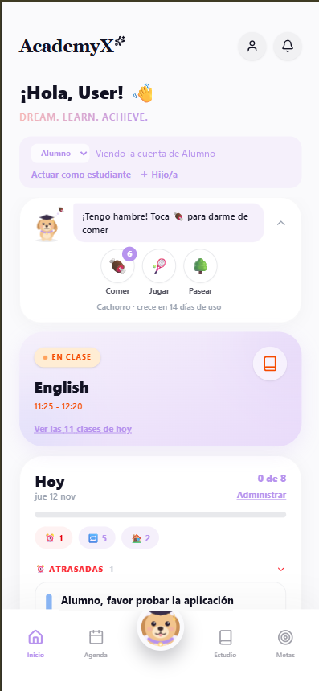
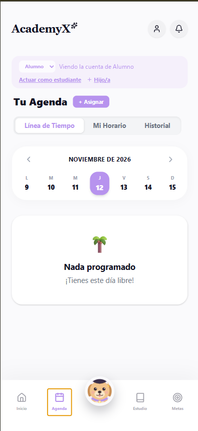
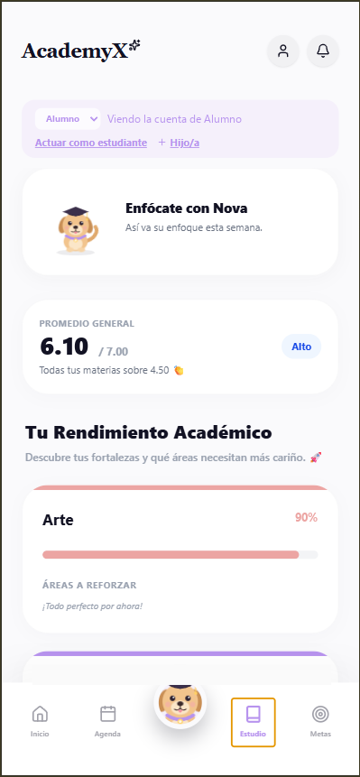
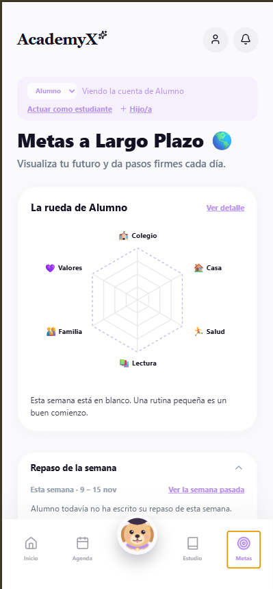
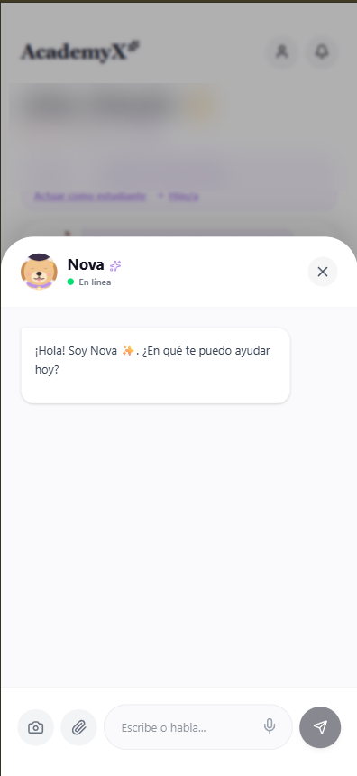

# AcademyX

Aplicación de **organización escolar familiar con gamificación**, instalable en el celular (PWA). Reúne la agenda, las tareas, las notas y las metas de los hijos, con una mascota que se cuida, un modo pensado para niños y un asistente de IA llamado Nova.

**Estado:** en uso por un hogar pequeño. · **Sitio:** [academyx-c0135.web.app](https://academyx-c0135.web.app/) (acceso con cuenta)

  
  
  
  
  

*Inicio, Agenda, Estudio, Metas y el asistente Nova. En las capturas, los nombres se sustituyeron por «User» y «Alumno» y las notas son valores ilustrativos.*

## Qué ofrece

- **Inicio:** saludo, selector entre las cuentas de los hijos con la opción de actuar como estudiante, la clase en curso, las tareas del día y las atrasadas.
- **Mascota que se cuida:** el estudiante la alimenta, juega con ella y la saca a pasear, y crece con los días de uso. Es el motor de la gamificación, junto con los puntos de experiencia, los niveles y un cuadro de honor.
- **Agenda:** línea de tiempo, horario semanal e historial, con asignación de tareas entre miembros de la familia.
- **Estudio:** promedio general y rendimiento por materia, con las áreas a reforzar y un resumen semanal de enfoque.
- **Metas a largo plazo:** una «rueda» con seis dimensiones (colegio, casa, salud, lectura, familia y valores) y un repaso semanal escrito por el estudiante.
- **Nova, el asistente de IA:** conversa por texto o voz y acepta fotos y adjuntos.
- **Modo niño,** temporizador de enfoque, importación de notas y recordatorios desde funciones en la nube.

## Stack

React · Vite · JavaScript y TypeScript · Firebase (Authentication, Firestore, Cloud Functions, Hosting) · PWA · GitHub Actions

## En cifras

| | |
|---|---|
| Commits | 61 (19 de agosto al 13 de octubre de 2026) |
| Archivos de prueba | 14: unitarias, de navegador y de reglas de seguridad |
| Despliegue | Automático desde GitHub Actions |

## Calidad

Tras una auditoría interna, el proyecto lleva una **bitácora de remediación** con lo hecho y lo pendiente. Un ejemplo de decisión: los puntos de experiencia se otorgan de forma **atómica e idempotente** con transacciones, para que completar una tarea dos veces no sume dos veces.

## Datos de menores

Es una aplicación de uso familiar con datos de menores, por eso es privada y sus datos reales no aparecen en este repositorio.

El código es privado.
