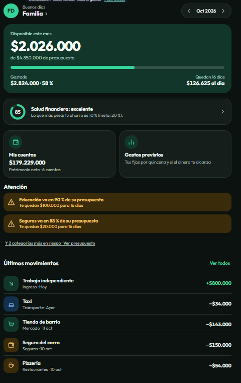
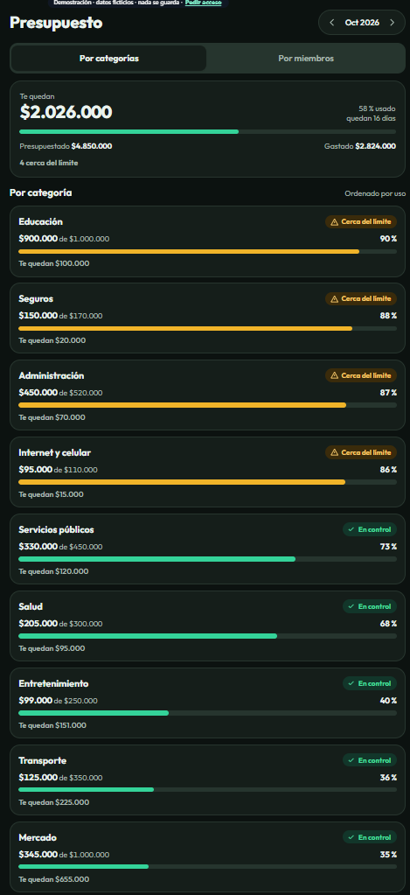

# Cosechas

Aplicación web instalable (PWA) de **finanzas familiares**, pensada para el celular, en español y con el contexto colombiano: pesos, TRM, bancos locales, SMS y extractos.

**Estado:** beta cerrada, por invitación. · **Demo con datos ficticios:** [cosechas-2a6cf.web.app/demo](https://cosechas-2a6cf.web.app/demo/) · **Caso de estudio completo:** [cosechas-2a6cf.web.app/caso-de-estudio](https://cosechas-2a6cf.web.app/caso-de-estudio/)

*Capturas de la demo, con datos ficticios.*

## Qué resuelve

- **Registrar sin digitar:** el SMS del banco llega al formulario ya leído, se importan extractos, y se sugieren categoría y cuenta aprendidas del historial. Siempre se revisa antes de guardar.
- **Ver el dinero completo:** cuentas, préstamos, bienes, dólares con la TRM oficial y patrimonio neto.
- **Planear y entender:** presupuesto por categoría y por miembro, gastos previstos por quincena, y análisis de gastos, ingresos, ahorro y patrimonio.
- **En familia:** varios miembros por invitación, presupuesto por miembro y proyectos aparte de los gastos del mes.
- **Privacidad:** acceso con lista de personas autorizadas; el texto de los SMS nunca se envía a un servidor.

## Stack

React 19 · TypeScript · Vite · Firebase (Authentication, Firestore, Hosting) · Recharts · PWA · Vitest · GitHub Actions

## En cifras

| | |
|---|---|
| Commits | 124 (5 al 30 de octubre de 2026) |
| Archivos de prueba | 101, incluidas pruebas de las reglas de seguridad de la base de datos |
| Integración continua | Lint, verificación de tipos, pruebas, build y presupuesto de rendimiento: el flujo falla si el paquete de JavaScript lo supera |

## Decisiones que vale la pena contar

- **Ahorro real, no «lo que sobró»:** la tasa de ahorro cuenta solo los traspasos a cuentas de ahorro e inversión.
- **Un indicador que no halaga:** el mes en curso no se evalúa como un mes completo; se compara con el anterior a la misma fecha.
- **Clasificación explicable, sin IA:** reglas más memoria del historial, para que sea privada, predecible y sin costo variable.

El código es privado y propietario. Puedo mostrarlo en una sesión si es útil.
