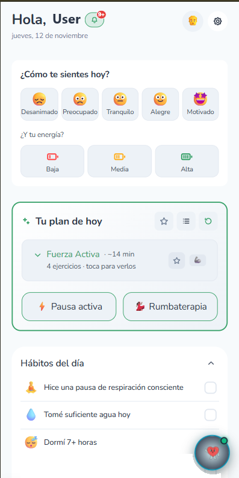
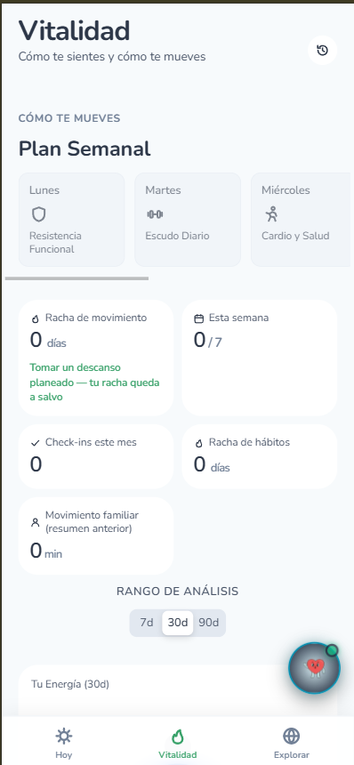
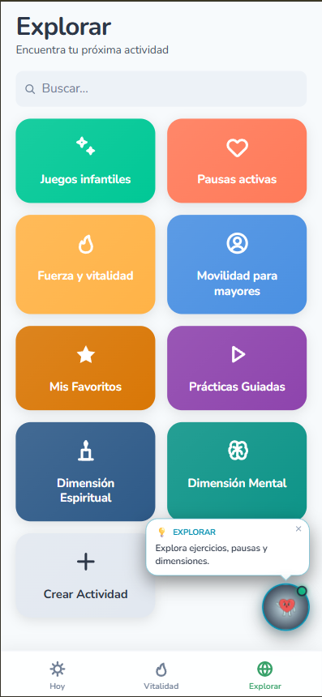

# FamilyGym

Aplicación de **bienestar familiar y gamificación**, pensada para fomentar el movimiento y las pausas activas en casa. Lejos de los enfoques clínicos o de los rastreadores de gimnasio, convierte las rutinas en una experiencia lúdica y accesible para todas las edades.

**Estado:** en uso por un grupo de familias pequeño. · **Sitio:** [gym-ordoc.web.app](https://gym-ordoc.web.app/) (acceso con cuenta)

  
  
  

*Hoy, Vitalidad y Explorar. Capturas de la aplicación, con el nombre del usuario sustituido por «User» y la lista de hábitos recortada.*

## Qué ofrece

- **Hoy:** registro del estado de ánimo y de la energía, un plan del día con una rutina sugerida (por ejemplo, fuerza activa en unos 14 minutos), accesos a pausas activas y a baile, y una lista de hábitos del día.
- **Vitalidad:** plan semanal de movimiento, rachas de movimiento y de hábitos, check-ins del mes, movimiento familiar y un rango de análisis de 7, 30 o 90 días.
- **Explorar:** buscador y categorías: juegos infantiles, pausas activas, fuerza y vitalidad, movilidad para mayores, favoritos, prácticas guiadas, dimensión espiritual y dimensión mental, además de la creación de actividades propias.
- **Zonas de vitalidad:** ejercicios agrupados por colores, en vez de por músculos.
- **Compañero flotante** que saluda y orienta en cada pantalla.
- **Pensada para toda la familia,** desde niños hasta adultos mayores.

## Stack

React · Zustand · Vite · Firebase (Authentication, Firestore, Hosting, Cloud Functions) · GitHub Actions

## En cifras

| | |
|---|---|
| Commits | 436 (18 de julio al 16 de octubre de 2026) |
| Archivos de prueba | 44, incluidas pruebas de las reglas de seguridad de la base de datos |
| Integración continua | Sí, con dos flujos de trabajo: pruebas y despliegue |

El proyecto tiene además auditorías funcional y técnica documentadas.

El código es privado.
