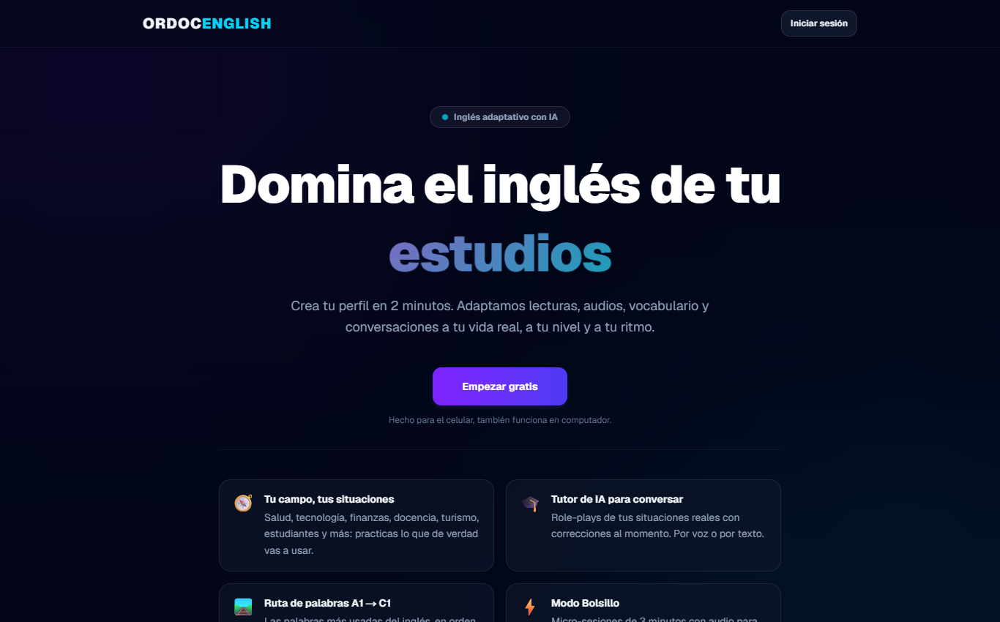

# Ordoc English

Aplicación de aprendizaje de **inglés con IA**, pensada primero para el celular y construida para un hogar pequeño de usuarios reales, no como un producto general. Combina un currículo estructurado de 9 meses con lecciones generadas por IA, práctica por voz y seguimiento del progreso.

**Estado:** en uso por un hogar pequeño. · **Sitio:** [ordoc-english.us-east4.hosted.app](https://ordoc-english--ordoc-english.us-east4.hosted.app/)

*Captura de la página pública. La aplicación requiere iniciar sesión.*

## Qué ofrece

- **Contenido según tu campo y tus situaciones:** salud, tecnología, finanzas, docencia, turismo, estudios y vida diaria.
- **Tutor de IA para conversar:** role-plays de situaciones reales, con corrección al momento, por voz o por texto.
- **Ruta de palabras de A1 a C1:** vocabulario en orden de uso, con repaso espaciado.
- **Modo bolsillo:** micro-sesiones de 3 minutos con audio.

## Stack

Next.js 16 (App Router) · React 19 · TypeScript · Firebase (Authentication, Firestore) · Google Gemini · Recharts · GitHub Actions

## Medición

- **Para quien la usa:** panel diario, progreso, una página de analítica personal y un informe semanal.
- **Para el administrador:** *métricas de enganche*, con usuarios registrados, activos en los últimos 7 y 30 días, retención por día desde el registro, sesiones, porcentaje de contenido repetido y qué actividades se practican más. Las cifras se calculan en el servidor y se guardan una hora en caché. Hay además un panel de uso.

## En cifras

| | |
|---|---|
| Pruebas automáticas | Más de 350 (unitarias y de navegador) |
| Desarrollo | 4 de julio al 7 de noviembre de 2026 |
| Integración continua | Sí |

## Decisiones de diseño

- **Un solo punto de escritura del progreso:** cada módulo de práctica registra su resultado por la misma vía, y solo ahí se actualizan el historial, las rachas, el cuaderno de errores y la fase del currículo. Un módulo nuevo extiende ese comportamiento en vez de crear su propio camino de datos.
- **Pocas llamadas al modelo:** el contenido generado se guarda en caché por usuario, nivel y sector, y todo lo que se puede calcular sin IA se calcula localmente: diferencias de palabras, cortes por nivel, palabras por minuto y rachas.
- **Funciona aunque la IA falle:** cada llamada al modelo tiene una alternativa determinista sin conexión, de modo que la aplicación sigue operando si se agota la cuota.

El código es privado.
