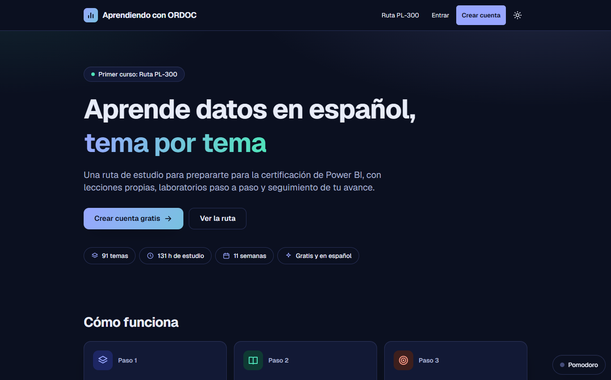

# Aprendiendo con ORDOC

Plataforma de cursos en español. El primer curso es una **ruta gratuita para preparar el examen PL-300 de Power BI**, con lecciones propias, laboratorios paso a paso con conjuntos de datos originales y seguimiento del avance. Plataforma independiente, no afiliada a Microsoft.

**Estado:** en construcción. Hay 9 lecciones escritas de 91 temas planeados. · **Sitio:** [ordocedtech.vercel.app](https://ordocedtech.vercel.app/)

## Qué ofrece

- **91 temas, 131 horas, 11 semanas** ordenados por los dominios del examen.
- **Una plantilla fija por lección:** qué es y para qué sirve, cómo funciona, la trampa típica del examen, un mini-laboratorio, un quiz de validación y enlace oficial para profundizar.
- **Seguimiento:** progreso por tema, rachas, horas de estudio y un temporizador Pomodoro.
- **Audio de las lecciones** y accesibilidad cuidada.

## Stack

Next.js 16 · React 19 · TypeScript estricto · Tailwind · Supabase (Auth y Postgres con seguridad por fila) · MDX · Vitest · Vercel

## Medición

- **Para quien la usa:** un panel de estudio con racha actual y mejor racha, minutos de la semana y totales, sesiones, precisión por dominio del examen, temas más débiles y un ritmo que compara las horas restantes con el plan.
- **Para el administrador:** hoy cubre la aprobación de contenido y las invitaciones. Las estadísticas agregadas y anónimas están en preparación, con un consentimiento explícito de cada persona.

## En cifras

| | |
|---|---|
| Lecciones escritas | 9 de 91 temas, con unas 10 mil palabras y 81 preguntas de quiz |
| Pruebas automáticas | Más de 250, más pruebas de navegador manuales |
| Desarrollo | Desde el 10 de noviembre de 2026 |

## Decisiones de calidad

- **El contenido se trata como código:** las lecciones viven en el repositorio, y un lint rompe la publicación si falta una sección, un dato obligatorio o queda una marca de verificación pendiente.
- **Aprobación atada al texto:** cada lección se aprueba contra una huella de su contenido, de modo que si el texto cambia, la aprobación deja de valer.
- **Reglas legales explícitas:** todo en palabras propias, sin copiar de Microsoft Learn y sin preguntas de exámenes reales.
- **Pruebas de seguridad y de accesibilidad:** las políticas de acceso a la base de datos se comprueban con un script, y el contraste y el desbordamiento se miden en ambos temas.

El código es privado.
